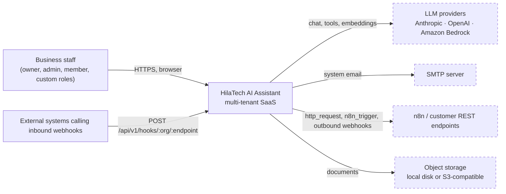
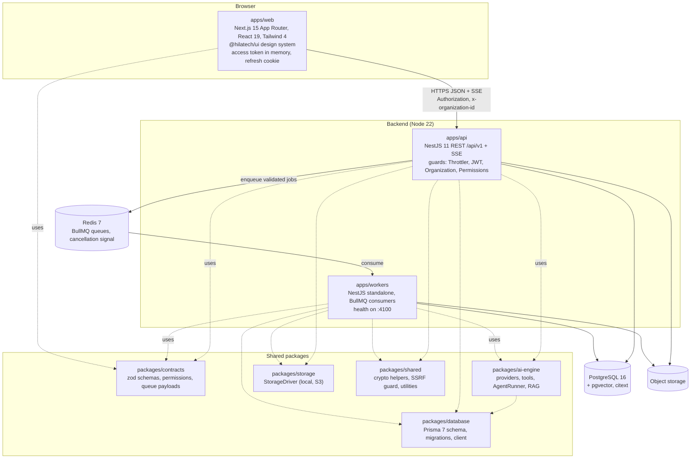
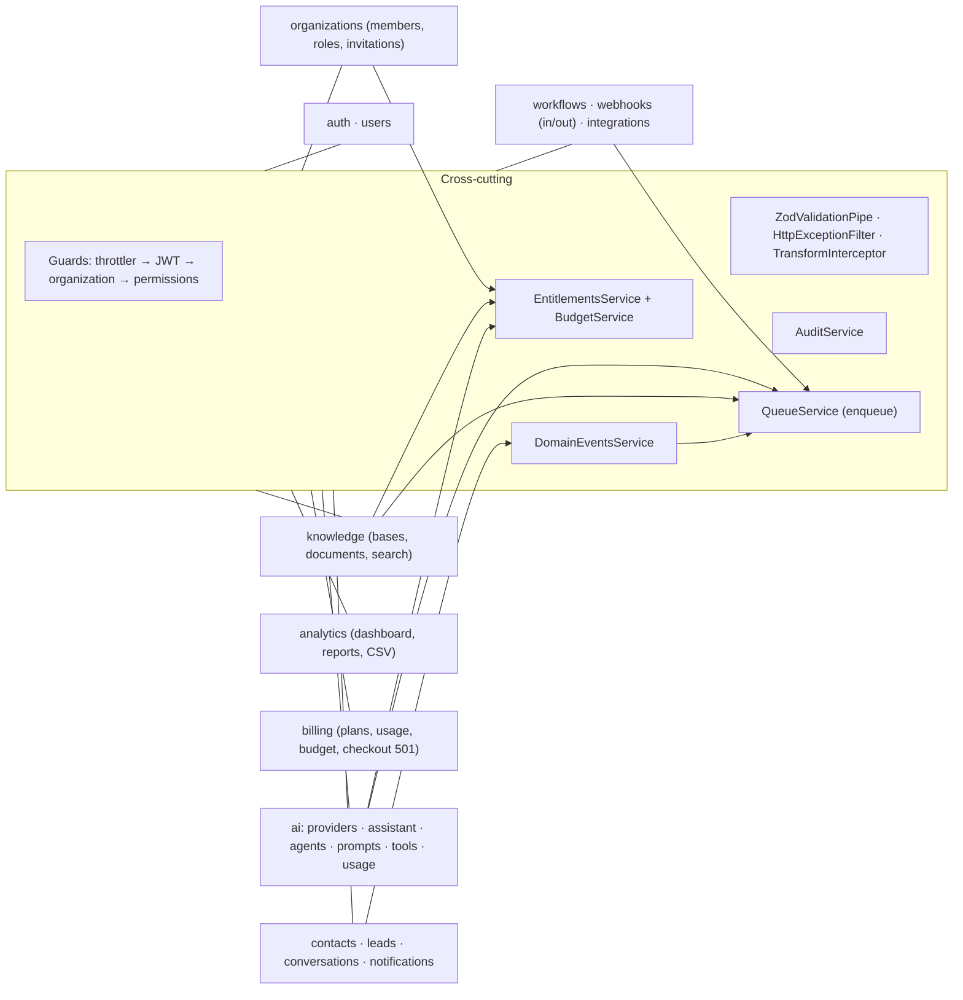

# System Overview (C4)

Companion to [overview.md](./overview.md) (conventions and request lifecycle). This document is a C4-style
description of what is actually in the repository on 2026-11-10. Dashed boxes are external systems that are **not
verified live**.

## Level 1 — System context

Customers of the tenants (end customers) are **not** users of the system: there is no customer-facing channel, widget or
portal. Conversations and messages are recorded by staff.

External integrations and their verification state: live LLM calls — never made (mock provider only; Bedrock tested
against a mocked SDK); SMTP — `smtp` driver implemented, never exercised; n8n — tested against a local HTTP server;
object storage — local disk verified, S3 driver unit-tested only; WhatsApp / external CRM / payments — not integrated.

## Level 2 — Containers

| Container      | Responsibility                                                                                                                                                                                                                            | Key paths                                           |
| -------------- | ----------------------------------------------------------------------------------------------------------------------------------------------------------------------------------------------------------------------------------------- | --------------------------------------------------- |
| `apps/web`     | Dashboard SPA-style app. Route groups: `(marketing)` landing, `(auth)`, `(onboarding)`, `(app)` (authenticated, permission-aware navigation). Talks only to the API.                                                                      | `src/app`, `src/lib/api`, `src/stores/session.ts`   |
| `apps/api`     | All business logic, authorization, tenant isolation, audit, entitlements, budget admission, SSE streaming for the assistant, inbound webhook ingress.                                                                                     | `src/modules/*`, `src/common`, `src/infrastructure` |
| `apps/workers` | Asynchronous work: document extraction/chunking/embedding, async agent executions and conversation summaries, workflow execution and cron scheduling, outbound webhook delivery, email, notification rows, analytics roll-up (logs only). | `src/processors`, `src/automation`, `src/ai`        |
| `packages/*`   | See diagram. `contracts` is the single source of truth for the API surface and queue payloads.                                                                                                                                            |                                                     |

Not deployed as separate containers: there is no separate AI service, vector database, search engine or API gateway.
n8n is an optional external system. `infra/cdk` describes an AWS deployment (ECS Fargate for the three apps, ALB, RDS,
ElastiCache, S3, Secrets Manager, WAF); it has **never been deployed**.

## Level 3 — API components (`apps/api/src/modules`)

## Level 3 — Worker components (`apps/workers/src`)

| Queue                 | Processor                                                                                                                            | State                                                                                             |
| --------------------- | ------------------------------------------------------------------------------------------------------------------------------------ | ------------------------------------------------------------------------------------------------- |
| `document-processing` | extract (text/markdown/csv/json/html built in, PDF via `pdf-parse`), chunk, embed, write pgvector, mark `ready`/`failed`, emit event | Verified with mock embeddings                                                                     |
| `embeddings`          | `EmbeddingsProcessor` (stub)                                                                                                         | Completes with `skipped / not_implemented`; embedding currently runs inside `document-processing` |
| `ai-tasks`            | async agent executions, conversation summaries; `lead_enrichment` kind not implemented                                               | Verified with mock provider                                                                       |
| `automation`          | `execute`, `event` fan-out, `resume` (after `delay`), `schedule_tick` (every minute, org time zone)                                  | Verified (scheduler loop itself not exercised)                                                    |
| `webhook-delivery`    | HMAC-signed outbound requests, SSRF guard, 5 attempts with exponential backoff                                                       | Verified                                                                                          |
| `email`               | templates verify_email, password_reset, invitation, notification_digest, generic; drivers `log` (default) and `smtp`                 | `log` verified; `smtp` never exercised                                                            |
| `notifications`       | idempotent `Notification` row write (the API normally writes in-app rows synchronously)                                              | Verified                                                                                          |
| `analytics`           | `daily_rollup` computes and logs counts (no table, not persisted); `usage_rollup` not implemented                                    | Partial                                                                                           |

## Key runtime flows

1. **Request**: browser → `Authorization: Bearer` + `x-organization-id` → guards build `TenantContext` → controller validates with
   zod → service queries with `organizationId` → `{ data, meta }` or `{ error }` envelope. Details in
   [tenant-isolation.md](./tenant-isolation.md).
2. **Assistant message**: `POST /assistant/threads/:id/messages` → entitlement + budget admission → `AgentRunner` (assistant profile) runs in
   the API process → provider stream relayed as SSE → usage and audit rows written.
3. **Document ingestion**: upload → `Document(uploaded)` + object → `document-processing` job → chunks → vectors → `ready` →
   `document.processed` event → searchable via `/knowledge/search` and the `knowledge.search` tool.
4. **Automation**: domain event / cron tick / manual run / inbound webhook → `WorkflowExecution(queued)` →
   `automation.execute` → `WorkflowRunner` steps → step results persisted → notifications, CRM updates, HTTP/n8n calls,
   outbound webhook deliveries.
5. **Async agent run**: `POST /agents/:id/execute` (async) → `AgentExecution(queued)` → `ai-tasks` job → worker resolves the
   user's current permissions → runner with budgets → steps persisted; cancel via `POST /agents/executions/:id/cancel`
   (Redis signal).

## Deployment shapes

| Shape                                                         | Status                                                   |
| ------------------------------------------------------------- | -------------------------------------------------------- |
| Local dev: `docker compose up -d postgres redis` + `pnpm dev` | Used for all verification in this repository             |
| `docker compose --profile app up --build` (three app images)  | Defined; images never built in the authoring sandbox     |
| AWS via `infra/cdk` (see `docs/operations/aws-*`)             | `cdk synth` and template assertions only; never deployed |
